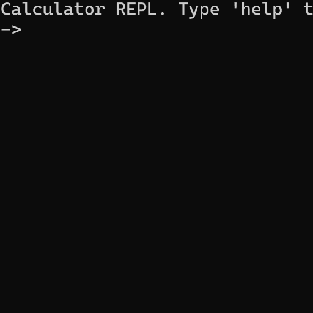

# calculator-repl
A lightweight calculator REPL written entirely in C using recursive-descent parsing.

## Project Demo

## Features

- Interactivity via REPL
- Error detection
- Error description
- Early recursion escape on error
- Functions (e.g., trigonometric)
- Caret index notation
- Variables
- Doxygen support

Please read CFG.txt for a comprehensive definition of the calculator's language features.

## Requirements

- C23
- GCC 14+ (or another suitable compiler)

## Acknowledgements
Generative AI was used to check my work, help refactor, explain libraries, and pinpoint needle-in-a-haystack bugs.
